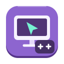
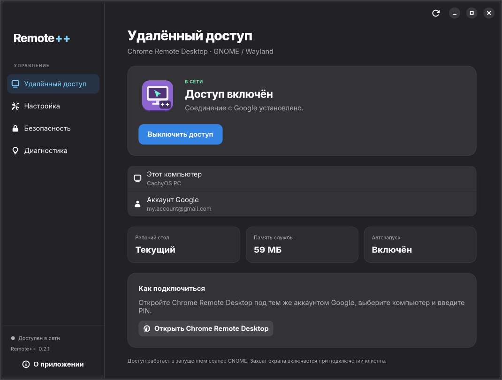
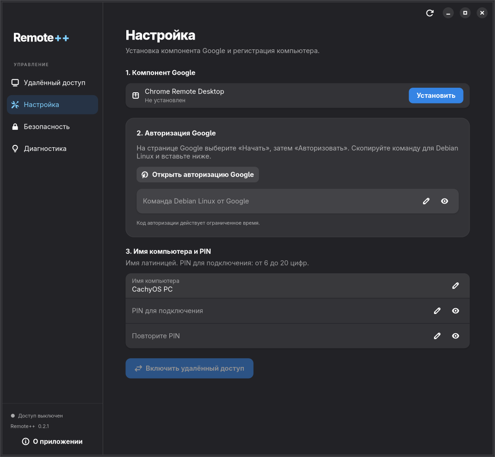

<p align="center"></p>
<h1 align="center">Remote++</h1>
<p align="center">Настройка Chrome Remote Desktop для GNOME на Wayland</p>

Нативный установщик и настройщик **Chrome Remote Desktop для CachyOS / Arch
с GNOME на Wayland**. Подключение к текущему рабочему столу через клиент Google
с телефона или другого компьютера.

Remote++ использует готовый компонент Google и запускает его в текущей
графической сессии. Приложение не создаёт отдельный виртуальный рабочий стол.
Интерфейс — GTK4/libadwaita, светлая и тёмная тема, адаптация к узкому окну.



## Установка

В релизе скачайте `remote-plus-plus-0.2.1-installer.run` и запустите:

```bash
chmod +x remote-plus-plus-0.2.1-installer.run
./remote-plus-plus-0.2.1-installer.run
```

Установщик добавит **Remote++** в меню приложений и сразу откроет его.
Если исполняемый файл уже имеет разрешение на запуск, его можно открыть
из файлового менеджера. В GNOME при отсутствии действия «Запустить» используйте
команды выше.

Из исходников или распакованного `.tar.gz`:

```bash
./install.sh
```

Приложение устанавливается для текущего пользователя. **Не запускайте установщик
через sudo.** Права администратора будут запрошены отдельным системным диалогом
только для установки недостающих пакетов и компонента Google.

## Первое подключение

1. В разделе **«Настройка»** нажмите **«Установить»**, если компонент Google отсутствует.
2. Нажмите **«Открыть авторизацию Google»**. На странице Google выберите
   «Начать» → «Далее» → «Авторизовать» и скопируйте команду для **Debian Linux**.
3. Вставьте её в Remote++. Самостоятельно выполнять эту команду в терминале не нужно.
4. Задайте имя компьютера латиницей и свой PIN (6–20 цифр). Нажмите
   **«Включить удалённый доступ»**.
5. На другом устройстве откройте [Chrome Remote Desktop](https://remotedesktop.google.com/access)
   под тем же Google-аккаунтом, выберите этот компьютер и введите PIN.

Одноразовый код Google имеет ограниченный срок действия. Если он истёк,
получите новую команду и повторите привязку. PIN и код авторизации не сохраняются
в открытом виде. Сам Google-компонент хранит необходимые ключи регистрации
в файле с правами `0600`.



## Ежедневное использование

- **Удалённый доступ:** состояние связи с Google, имя компьютера, аккаунт и память службы.
- **Безопасность:** смена PIN, автозапуск при входе и выключение доступа.
- **Настройка:** привязка другого аккаунта.
- **Диагностика:** журнал с маскировкой адреса аккаунта и секретов, копирование для поддержки.

Закрытие Remote++ не прерывает доступ. Кнопка **«Выключить доступ»** останавливает
службу и отключает автозапуск. Смена PIN перезапускает службу и разрывает текущие
подключения. Привязанные ранее доверенные клиенты Google могут сохранять доверие;
для полного отзыва доступа удалите компьютер на странице Google.

**Захват по подключению (0.2):** небольшой нативный модуль откладывает запрос
Mutter `CreateSession` до успешной авторизации клиента Google. В ожидании
подключения сеанс захвата не создаётся. После отключения последнего клиента
Remote++ завершает дочерний хост и запускает его заново в режиме ожидания;
значок GNOME исчезает. Возврат в сеть занимает несколько секунд.

Исходные файлы Google в `/opt` не изменяются. Модуль подключается только к
дочернему Chrome-хосту, системный индикатор GNOME работает как обычно.
Проверяется SHA-256 конкретной сборки Google: при неизвестном обновлении
Remote++ отказывается запускать доступ до проверки совместимости.
Подробности: [устройство модуля](docs/CAPTURE_ON_DEMAND.md).

Если доступ уже настроен способом с `crd-current-session.service`, Remote++
использует существующую регистрацию и состояние службы. Переустановка приложения не
меняет аккаунт или PIN. При обновлении уже настроенная интеграция автоматически
получает модуль захвата. Работающая служба перезапускается, поэтому текущий
удалённый сеанс кратковременно прервётся. Если доступ был выключен, установщик
оставляет его выключенным. Автозапуск сохраняет прежнее состояние.

## Поддержка и ограничения

- CachyOS / Arch Linux, **x86_64**, **GNOME на Wayland**.
- Проверено с GNOME 51 и компонентом Chrome Remote Desktop **157.0.8103.19**.
- KDE, другие композиторы, X11 и ARM этой версией не поддерживаются.
- Компьютер должен быть включён, подключён к интернету; локальная сессия пользователя
  должна быть запущена. Вход с экрана GDM до локального входа не реализован.
- Поведение при блокировке экрана зависит от версии GNOME. Перед поездкой проверьте
  блокировку и повторное подключение с другого устройства. Приложение не отключает
  блокировку, сон или другие системные ограничения.
- Неофициальная интеграция: будущие обновления Google/GNOME могут потребовать обновления Remote++.
- Это клиент инфраструктуры Google. Свой сервер, проброс портов и установка VPN не нужны;
  доступность соединения зависит от интернет-сети и служб Google.

## Как устанавливается компонент Google

Если компонент уже установлен, Remote++ использует его и не заменяет пакет.
Для чистой системы поставляется небольшой проверяемый `packaging/host/PKGBUILD`:

1. Бинарный `.deb` скачивается **напрямую с `dl.google.com`**.
2. `makepkg` проверяет закреплённую SHA-256 и собирает локальный пакет без компиляции Chromium.
3. `pacman -U` устанавливает `remote-plus-plus-host` с системным запросом прав администратора.

Чужие PKGBUILD и shell-скрипты из интернета не выполняются. Google-бинарники
не включены в GitHub-репозиторий или установщик Remote++. При обновлении версии
host-пакета нужно обновить URL/версию и контрольную сумму в PKGBUILD и повторить
проверку подключения; автоматическое скачивание непроверенной `latest` отключено.

## Файлы и управление службой

```text
~/.local/share/remote-plus-plus/                         приложение
~/.local/bin/remote-plus-plus                          команда запуска
~/.local/share/applications/io.github.edgarsskills.RemotePlusPlus.desktop
~/.config/systemd/user/crd-current-session.service       служба текущего сеанса
~/.config/chrome-remote-desktop/host#<hash>.json          регистрация Google
```

```bash
systemctl --user status crd-current-session.service
systemctl --user disable --now crd-current-session.service
journalctl --user -u crd-current-session.service -n 80
```

При отвязке в приложении регистрация перемещается в приватный файл
`.json.disconnected-<timestamp>`, чтобы можно было восстановить настройку.
Копировать такие файлы, журналы регистрации или папку `~/.config/chrome-remote-desktop`
в публичный репозиторий не нужно.

## Разработка и сборка

```bash
python -m unittest discover -s tests -v
python packaging/build.py
```

Для нативного теста нужны `gcc`, `pkgconf`, `glib2` и `dbus`. Он запускает
собственную D-Bus-шину и не обращается к реальному рабочему столу.

В `dist/` появятся `.run`, `.tar.gz`, исходники `.zip` и `SHA256SUMS`.
Для просмотра дизайна без чтения регистрации и изменения системы:

```bash
python app.py --preview
```

Снимки интерфейса (нужны `xorg-server-xvfb`, `dbus`, `gcc`, GTK4 development files):

```bash
GTK_A11Y=none GIO_USE_VFS=local GSETTINGS_BACKEND=memory GSK_RENDERER=cairo \
  xvfb-run -a -s '-screen 0 1600x1200x24' \
  dbus-run-session python tests/render_ui.py --output docs/screenshots
```

Шаблон GitHub Actions в `docs/ci/checks.yml` запускает модульные проверки и
собирает скачиваемые артефакты. Для включения CI скопируйте его в
`.github/workflows/checks.yml` в своём репозитории.
Для публикации загрузите **содержимое этой папки** в репозиторий, например
`edgarsskills-fix/remote-plus-plus`. Архивы из `dist/` можно прикрепить к GitHub Release.
Ни токен GitHub, ни регистрация Google для сборки исходников не нужны.

MIT. Подробности о Google и других компонентах: [THIRD_PARTY.md](THIRD_PARTY.md).
